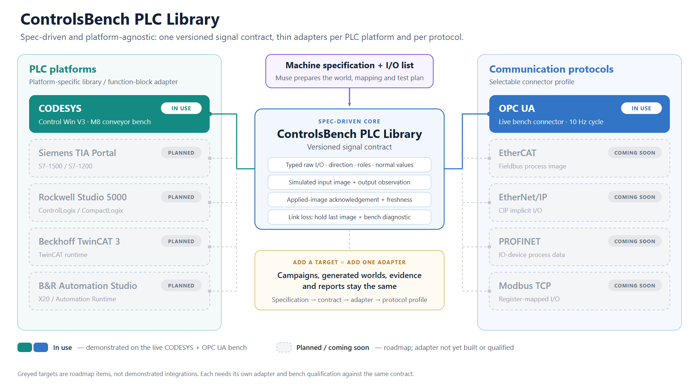

# ControlsBench Muse — submission diagrams

Open [the gallery](index.html) for the three architecture diagrams, with editable SVG, PNG, Mermaid source, captions and claim notes. The platform overview below has a PNG and SVG.

## Platform overview

[Open the demo PNG](controlsbench-plc-library-targets-demo.png) · [Editable SVG](controlsbench-plc-library-targets.svg)

The live CODESYS/OPC UA bench uses the M8 application-local interceptor; the reusable Core library is compiled separately and has not been deployed in those live runs. Greyed platforms and protocols are planned, not demonstrated.

The primary architecture is **agnostic interfaces with populated demo choices**. The main boxes say AI model adapter, Connection adapter, Controller platform and PLC integration adapter. Smaller Demo selection labels contain Muse Wonder / Meta API, OPC UA, CODESYS Control Win and M8 demo FB. Those are the current configuration, rather than definitions of the product architecture.

1. [Architecture PNG](controlsbench-architecture.png): the product's component and evidence flow.
2. [Live-loop PNG](controlsbench-live-loop.png): the execution and adaptation pattern, with the conveyor investigation as an example.
3. [PLC-integration PNG](controlsbench-plc-integration.png): common raw-I/O/session semantics and platform-specific library implementations.

Other adapter bindings require implementation and qualification; the diagrams do not claim all vendor support exists. The reusable Core0.2.0.0 is compiled, not deployed. The optional sink gate and AO support are prototype capabilities. Native PLC scan, model reasoning and connector cadence stay independent.

Rebuild the masters: node scripts/build-submission-diagrams.mjs
Render PNGs and hash manifest: node scripts/render-submission-diagrams.mjs

The reusable generation brief is ../submission-diagram-prompts.md.
