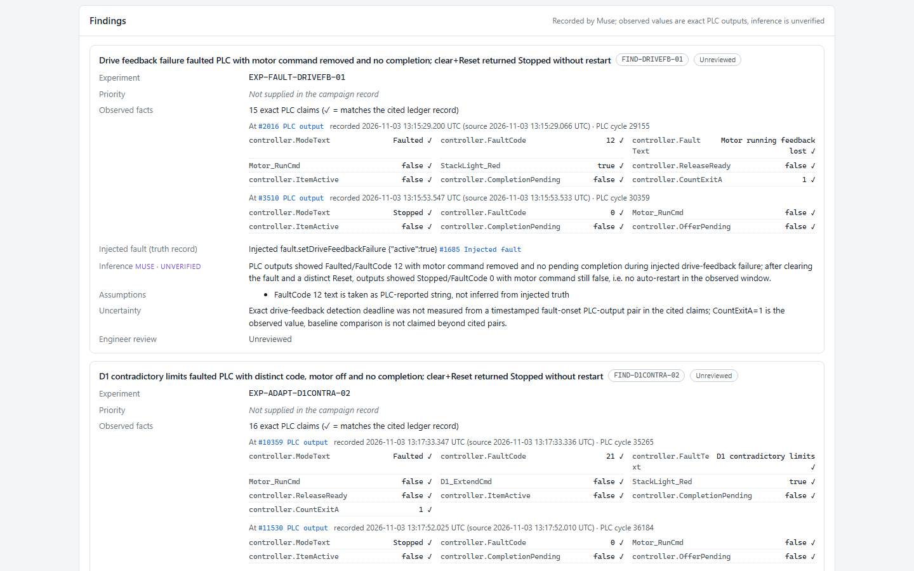
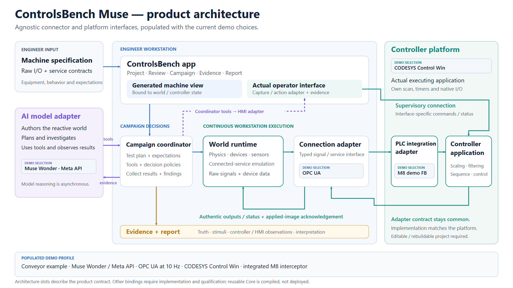

# ControlsBench Muse — start here

**An engineer supplies a machine specification. Muse builds a reactive world, investigates the executing controller, and records what happened.** The workstation engine maintains the raw-I/O loop while Muse reasons about the next experiment.

This folder is the short route through the submission evidence. Reports are presentations of saved runs; they do not start a PLC or make model requests. The runs below are separate experiments.

## 1. See the strongest result

**Muse chose a new test after seeing the PLC's response.** In the live W4 campaign it induced missing drive feedback, observed fault 12 and recovery, then proposed a distinct D1 contradictory-limit investigation absent from its initial plan. That produced fault 21 and a second recovery. Two findings contain 31 exact PLC claims traced to original controller observations.

- [Readable PDF report](reports/adaptive-plc-investigation.pdf)
- [Standalone HTML report](reports/adaptive-plc-investigation.html) — download and open locally
- [Original report JSON](records/w4-report.json), [campaign audit](records/w4-audit.json), [engineering review](records/w4-engineering-review.json)
- [Full explanation and original trace location](../docs/w4-live-proof.md)

## 2. See Muse operate the HMI

In a separate live trial, Muse chose browser-HMI actions, received **17 actual screenshot inputs**, and compared screen results with independent PLC observations. Start, Stop/coast, drive-overload display and Reset were supported in the exercised cases. Five model responses completed the campaign.

- [Readable PDF report](reports/muse-hmi-operation.pdf)
- [Standalone HTML report](reports/muse-hmi-operation.html)
- [Original report JSON](records/s2-report.json), [audit](records/s2-audit.json), [engineering review](records/s2-engineering-review.json)
- [Exact received overload screenshot](images/muse-received-overload.jpg)
- [Full explanation and original trace location](../docs/s2-hmi-proof.md)

**Scope:** the stale/disconnect HMI check remained inconclusive. The report retained one extra screenshot citation whose pixels were not sent; a separate, valid received frame supports the fault display. The engineering conclusion is `pass_with_limitations`; the original audit remains `reference_review_required`. This is a locally served browser HMI, not native CODESYS WebVisu or arbitrary-HMI discovery.

## 3. Check the continuous controller/world loop

A separate zero-model live campaign exercised normal A/B sorting, runout/misroute handling, physical coast on Stop and a failed divert through the executing PLC application. Its saved-evidence audit passed all 10 checks over 302 coherent images.

- [Result](records/normal-operation-result.json) and [audit](records/normal-operation-audit.json)
- [Scenario criteria, implementation and original transport traces](../docs/m10-live-integration.md)

This is deterministic controller integration evidence; it is not an autonomous Muse campaign.

## 4. Understand the architecture

[Architecture gallery and editable sources](../docs/submission-diagrams/README.md). The interfaces are agnostic; **Muse Wonder / Meta API, OPC UA, CODESYS Control Win and the M8 integration FB** are the populated, demonstrated choices. Additional vendors require adapters and qualification. The reusable library is compiled, not deployed in these live runs.

## 5. Inspect a partial result, too

[First HMI attempt report](reports/partial-hmi-attempt.pdf): the heartbeat lapsed before HMI actions began. It is preserved as partial and contributes no HMI success claims. [Original partial report](../artifacts/bench-report/saved-exports/s2-first-attempt-partial/report-bundle.json).

## What this proves today

The demonstration combines an AI-authored physical world, a continuously running raw-I/O engine, an executing PLC application, model-directed fault investigation, scoped HMI operation and reviewable reports. **CODESYS Control Win executes the PLC logic; no physical PLC CPU or machinery is claimed.** The model does not need to produce a fresh answer for every I/O update.

App-based spec upload and selected-world integration are undergoing final acceptance separately. These saved campaigns use the prepared conveyor; they do not establish that every new uploaded machine is live-qualified. The final acceptance must show the uploaded specification, exact generated world, plan and resulting live report remain connected.

## Provenance and navigation

- [Claim-to-evidence map](claims.md)
- [Three-minute video plan and narration](../docs/submission/demo-three-minute-cut.md)
- [Local recording desk and launch instructions](../docs/submission/recording-server.md)
- [Copy/source SHA-256 manifest](manifest.json)
- Rebuild the curated copies: `node scripts/build-submission-evidence.mjs`
- Check existing copies without writing: `node scripts/build-submission-evidence.mjs --check`

Original ledgers, model exchanges, failed attempts and native transport journals remain under `artifacts/`; this folder does not replace them or modify their verdicts. PDF/HTML reports were exported from the saved evidence. Screenshots of report pages are later presentation captures, not original live video.
